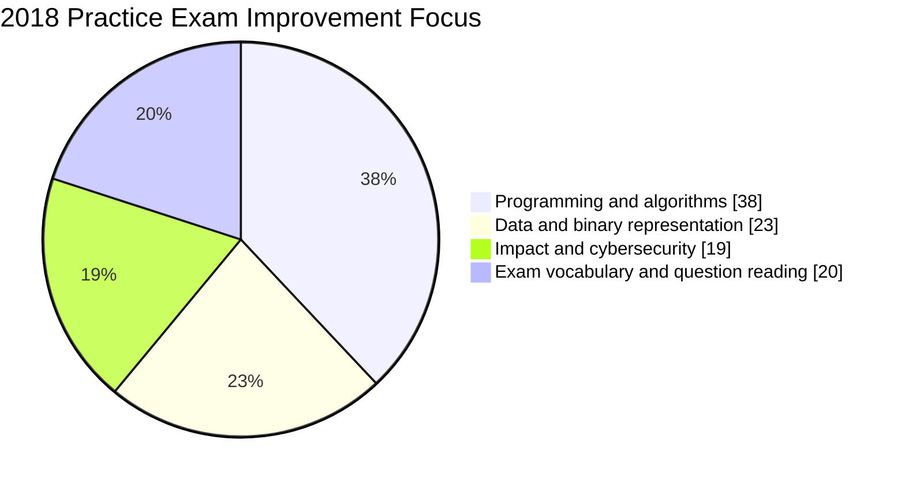
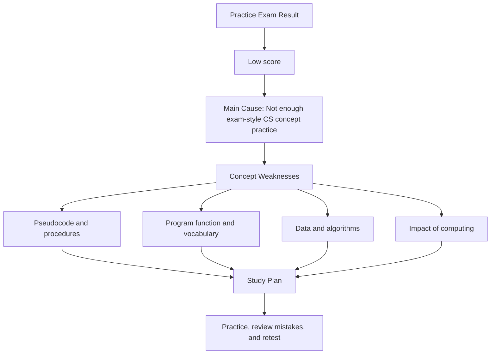

## Reflection

This practice exam gave me a more realistic picture of my current AP Computer Science Principles knowledge. The result was disappointing, but it was useful because it identified specific skills instead of giving me only one overall score. I completed the questions without looking up answers, so the report shows what I could recognize and apply independently.

The report contains 71 scored questions across the skills shown in the screenshots. Using the displayed percentages, my performance was approximately 18 correct answers out of 71, or about 25%. The exact total may vary slightly because the report rounds individual skill percentages.

My result is not evidence that I cannot learn computer science. It shows that my practical experience is ahead of my exam preparation. I have spent more time building projects, configuring tools, and troubleshooting errors than interpreting formal vocabulary, tracing unfamiliar pseudocode, and evaluating multiple-choice distractors.

The most important qualitative lesson is that I often know a general idea without knowing the precise AP CSP definition. For example, recognizing that a program uses data is different from explaining data abstraction, and knowing that an algorithm works is different from comparing its efficiency. I need to practice the language and reasoning process that the exam expects.

My goal is to use this result as a baseline. I will not simply reread every topic. I will target the skills with 0%–33% performance first, record why each answer was missed, and retest myself with questions that require the same type of reasoning.

## Fields To Improve

These percentages are study-time priorities, not additional exam scores. I assigned the largest share to programming and algorithms because several related skills were at 0%–25%, including Program Design and Development, Using Programs with Data, Mathematical Expressions, Conditionals, Lists, Developing Procedures, and Algorithmic Efficiency.

I will spend less time on skills that already show evidence of understanding, but I will still review them periodically. A strong result in one small category does not guarantee that I can transfer that knowledge to a new question or a larger unit.

## College Board Topic Map

The College Board AP Computer Science Principles course is organized around five big ideas: Creative Development, Data, Algorithms and Programming, Computer Systems and Networks, and Impact of Computing. My missed areas mostly connect to the following parts of the course framework.

| Skill shown in report | Questions | Result | College Board connection | Specific interpretation and response |
| --- | --- | --- | --- | --- |
| Program Design and Development | 1 | 0% | Creative Development | I need to identify a program's purpose, inputs, outputs, users, and constraints before evaluating whether a solution is successful. |
| Identifying and Correcting Errors | 4 | 25% | Creative Development | I should trace the exact line where a value or condition changes instead of guessing from the final output. |
| Binary Numbers | 4 | 25% | Data | I need to convert between binary and decimal and explain why a fixed number of bits limits the values that can be represented. |
| Data Compression | 3 | 33% | Data | I need to distinguish lossless compression from lossy compression and explain the tradeoff between file size and information quality. |
| Extracting Information from Data | 7 | 29% | Data | This is one of my largest tested categories. I need to interpret tables, patterns, and trends rather than choosing an answer from one isolated data point. |
| Using Programs with Data | 2 | 0% | Data and abstraction | I need to connect variables, lists, and data representations to the way a program stores, changes, and retrieves information. |
| Variables and Assignments | 3 | 67% | Algorithms and Programming | This is a relative strength. I can build on it by tracing reassignment in longer pseudocode problems. |
| Mathematical Expressions | 1 | 0% | Algorithms and Programming | I need to review operator order, integer behavior, and how expressions evaluate before a condition is checked. |
| Boolean Expressions | 3 | 33% | Algorithms and Programming | I need to evaluate each comparison separately and then apply AND, OR, and NOT precisely. |
| Conditionals | 2 | 0% | Algorithms and Programming | I need to practice deciding which branch runs for true and false conditions, including boundary cases. |
| Iteration | 2 | 50% | Algorithms and Programming | I understand some loop behavior, but I need to track initialization, update, and stopping conditions consistently. |
| Developing Algorithms | 4 | 25% | Algorithms and Programming | I need to explain the steps of an algorithm and test whether those steps work for normal and unusual inputs. |
| Lists | 1 | 0% | Algorithms and Programming | I need to review indexing, list updates, traversal, and the difference between a list's length and its final index. |
| Calling Procedures | 5 | 40% | Algorithms and Programming | I need to match arguments to parameters and track local values when a procedure is called more than once. |
| Developing Procedures | 2 | 0% | Abstraction | I need to practice writing and recognizing procedures with clear parameters, return values, and reusable purposes. |
| Random Values and Simulations | 4 | 50% combined | Algorithms and Programming | I can improve by identifying the repeated trial, random input, measured outcome, and number of repetitions in a simulation. |
| Algorithmic Efficiency | 2 | 0% | Algorithms and Programming | I need to compare how the number of steps grows as input size increases, not only whether an algorithm produces the right answer. |
| Undecidable Problems | 1 | 100% | Algorithms and Programming | This is a clear strength. I should maintain it while using review time on lower-scoring programming skills. |
| The Internet | 3 | 33% | Computer Systems and Networks | I need to connect packets, protocols, addresses, and routing to how information moves across the Internet. |
| Fault Tolerance | 1 | 100% | Computer Systems and Networks | This is another clear strength; I can explain how redundancy allows a system to continue operating after a component fails. |
| Beneficial and Harmful Effects | 3 | 0% | Impact of Computing | I need to evaluate both intended benefits and unintended consequences using evidence instead of making a one-sided claim. |
| Digital Divide | 1 | 0% | Impact of Computing | I need specific examples involving income, geography, infrastructure, devices, accessibility, and education. |
| Crowdsourcing | 2 | 100% | Impact of Computing | This is a strength. I understand how many contributors can provide information or solve parts of a larger problem. |
| Legal and Ethical Concerns | 2 | 50% | Impact of Computing | I need to distinguish legal requirements from ethical responsibilities and justify the impact on different stakeholders. |
| Safe Computing | 3 | 67% | Computer Systems and Networks | I have a usable foundation, but I should connect practices such as strong authentication and updates to the threats they reduce. |

## Weakness Pattern

The pattern is broader than one isolated topic. Seven questions in Extracting Information from Data produced only 29%, and several programming skills produced 0%–25%. This suggests that I need both content review and a better process for reading questions.

My strongest results were 100% in Undecidable Problems, Fault Tolerance, and Crowdsourcing. I also scored 67% in Variables and Assignments and Safe Computing, and 50% in Iteration, Random Values, Simulations, and Legal and Ethical Concerns. These results show that I can learn abstract concepts when I can connect them to a clear definition or example.

The weakest results were not limited to one unit. I scored 0% in Program Design and Development, Using Programs with Data, Mathematical Expressions, Conditionals, Lists, Developing Procedures, Algorithmic Efficiency, Beneficial and Harmful Effects, and Digital Divide. I therefore need a repeatable study routine instead of reviewing only one chapter.

## Priority List

| Priority | Focus Area | Reason |
| --- | --- | --- |
| 1 | Pseudocode, conditionals, lists, and procedures | These skills combine into the tracing questions where a small mistake in an index, condition, parameter, or return value changes the final answer. |
| 2 | Data interpretation and representation | Data included 7 Extracting Information questions at 29%, plus Binary Numbers at 25%, Data Compression at 33%, and Using Programs with Data at 0%. |
| 3 | Program design and algorithmic efficiency | I need to explain why an algorithm works, how it scales, and whether it meets the program's purpose. |
| 4 | Computing impacts and digital access | The 0% results in Beneficial and Harmful Effects and Digital Divide show that I need specific stakeholder-based examples. |
| 5 | Internet concepts and cybersecurity | The Internet result was 33%, while Safe Computing was 67%. I need to connect vocabulary such as packets, protocols, authentication, and encryption. |
| 6 | Maintain existing strengths | I should revisit the 100% categories and 67% categories every two weeks so that improvement in weak areas does not replace retained knowledge. |

## Next Steps

- **Days 1–3: vocabulary and definitions.** Create at least 30 flashcards for abstraction, binary, compression, procedure, parameter, argument, iteration, efficiency, protocol, encryption, digital divide, and bias. For each card, write one definition and one concrete example.
- **Days 4–6: pseudocode tracing.** Complete 15 short tracing problems. For every problem, record the starting values, each assignment, each loop iteration, and the final output in a table.
- **Days 7–9: procedures and data.** Write five small procedures that use parameters, return values, and lists. Test each procedure with a normal input, an empty or boundary input, and one unexpected input.
- **Days 10–12: algorithms and efficiency.** Compare linear search, binary search, a single loop, and a nested loop. Record the approximate number of steps for input sizes of 10, 100, and 1,000.
- **Days 13–14: impact and systems.** Write four short responses about the digital divide, computing bias, beneficial and harmful effects, and Internet reliability. Each response must name at least two stakeholders and one measurable consequence.
- **After the two-week cycle:** take a 20-question mixed quiz under timed conditions. My first measurable target is at least 14 correct answers, or 70%. A second target is no category below 50% on the next report.
- **Error review:** classify every missed question as a vocabulary mistake, tracing mistake, calculation mistake, misunderstood prompt, or unsupported guess. Then write the correct reasoning in one or two sentences.

## Summary

This score shows a clear difference between project-building experience and exam-ready conceptual knowledge. I performed best when the topic had a direct definition or a familiar system relationship: Undecidable Problems, Fault Tolerance, and Crowdsourcing were all 100%. I struggled most when I had to trace code, interpret data, compare algorithms, or discuss social consequences.

The next result should be judged against measurable goals rather than a vague feeling of improvement. I want to move from an estimated 25% baseline to at least 70% on a 20-question retest, reduce the number of 0% categories, and explain every missed answer with specific evidence. Qualitatively, I want my explanations to include the relevant vocabulary, the steps I followed, and why the other choices do not fit.

This practice exam was a setback, but it also provided a useful map. By studying in short sessions, practicing with data and pseudocode, and reviewing mistakes systematically, I can turn the report into a targeted preparation plan.

Source: [College Board AP Computer Science Principles Course Overview](https://apcentral.collegeboard.org/courses/ap-computer-science-principles)
